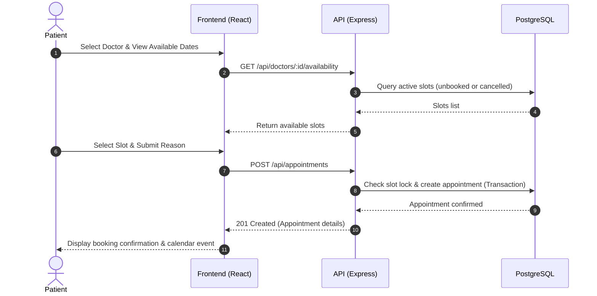
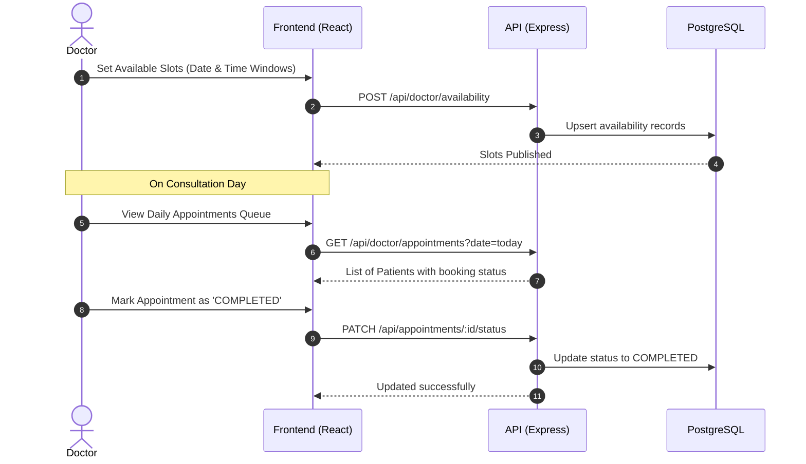

# Hospital Appointment Management System — Actor Relationships & Use Cases

This document describes the primary actors who interact with the **Hospital Appointment Management System**, their system permissions, and their functional workflows.

Separating this from the Database Entity-Relationship (ER) diagram provides a clear distinction between:
- **ER Diagram:** How information is modeled, normalized, and persisted in PostgreSQL.
- **Actor/Use-Case Diagram:** Who interacts with the system, what operations they can perform, and access boundaries.

---

## 1. System Actors

| Actor | Description | Primary Goal |
|---|---|---|
| **Patient** | End-user seeking medical consultation. | Find specialists, book appointment slots, view history, and cancel if needed. |
| **Doctor** | Healthcare practitioner offering medical services. | Define available slots, review scheduled appointments, and manage appointment outcomes. |
| **Receptionist** | Front-desk staff operating the hospital intake desk. | Book appointments on behalf of walk-in/call-in patients, manage schedule changes, check-in patients. |
| **Admin** | Hospital administrator managing system operations. | Onboard doctors, oversee user roles, audit activity, and maintain system integrity. |

---

## 2. Actor & Use Case Diagram (Mermaid)

```mermaid
flowchart TD
    %% Actors
    Patient(["👤 Patient"])
    Doctor(["🩺 Doctor"])
    Receptionist(["📋 Receptionist"])
    Admin(["🛡️ Admin"])

    subgraph AuthManagement ["Authentication & Profiles"]
        UC_Reg(["Register Account"])
        UC_Login(["Login (JWT)"])
        UC_Profile(["Manage Personal Profile"])
    end

    subgraph PatientDoctorFeatures ["Patient & Doctor Workflows"]
        UC_ViewDoctors(["Browse Doctors & Specialties"])
        UC_SetAvail(["Publish / Update Availability Slots"])
        UC_ViewSchedule(["View Doctor Schedule"])
        UC_BookAppt(["Book Appointment Slot"])
        UC_CancelAppt(["Cancel Appointment"])
        UC_ViewHistory(["View Appointment History"])
        UC_UpdateStatus(["Update Appointment Status<br/>(Completed / No Show)"])
    end

    subgraph AdminReceptionistFeatures ["Administrative & Operational Management"]
        UC_BookForPatient(["Book Appointment for Patient (Walk-in)"])
        UC_ManageAllAppts(["Reschedule / Manage All Bookings"])
        UC_ManageUsers(["Manage Users & Accounts"])
        UC_ManageDoctors(["Onboard & Verify Doctor Credentials"])
        UC_Audit(["System Auditing & Analytics"])
    end

    %% Patient Connections
    Patient --> UC_Reg
    Patient --> UC_Login
    Patient --> UC_Profile
    Patient --> UC_ViewDoctors
    Patient --> UC_BookAppt
    Patient --> UC_CancelAppt
    Patient --> UC_ViewHistory

    %% Doctor Connections
    Doctor --> UC_Login
    Doctor --> UC_Profile
    Doctor --> UC_SetAvail
    Doctor --> UC_ViewSchedule
    Doctor --> UC_UpdateStatus
    Doctor --> UC_ViewHistory

    %% Receptionist Connections
    Receptionist --> UC_Login
    Receptionist --> UC_ViewDoctors
    Receptionist --> UC_BookForPatient
    Receptionist --> UC_ManageAllAppts
    Receptionist --> UC_CancelAppt

    %% Admin Connections
    Admin --> UC_Login
    Admin --> UC_ManageUsers
    Admin --> UC_ManageDoctors
    Admin --> UC_Audit
    Admin --> UC_ManageAllAppts
```

---

## 3. Role-Based Access Control (RBAC) Matrix

| Feature / Action | Patient | Doctor | Receptionist | Admin |
|---|:---:|:---:|:---:|:---:|
| **Self Registration** | ✅ | ❌ (Admin created) | ❌ (Admin created) | ❌ |
| **Login / Session Auth** | ✅ | ✅ | ✅ | ✅ |
| **View Doctors & Profiles** | ✅ | ✅ | ✅ | ✅ |
| **Create Availability Slots** | ❌ | ✅ | ❌ | ✅ |
| **Book Own Appointment** | ✅ | ❌ | ❌ | ❌ |
| **Book on behalf of Patient** | ❌ | ❌ | ✅ | ✅ |
| **Cancel Own Appointment** | ✅ | ✅ | ✅ | ✅ |
| **Mark Completed / No-Show** | ❌ | ✅ | ✅ | ✅ |
| **Manage Users & Roles** | ❌ | ❌ | ❌ | ✅ |
| **Onboard / Verify Doctors** | ❌ | ❌ | ❌ | ✅ |

---

## 4. Key Actor Workflows

### 4.1 Patient Booking Journey

### 4.2 Doctor Slot Publishing & Consultation Journey

### 4.3 Receptionist Walk-in Assistance Journey
- Look up existing patient or register walk-in patient profile.
- Check live doctor availability schedule.
- Reserve slot directly under patient's record.
- Issue appointment slip / receipt.

---

## 5. Security & Isolation Summary
1. **JWT Verification:** Every protected endpoint decodes the Bearer token and verifies the caller's identity (`req.user.id`, `req.user.role`).
2. **Resource Ownership Check:**
   - A `PATIENT` can only view, fetch, or cancel appointments where `patient_id == req.user.patient_id`.
   - A `DOCTOR` can only update appointments assigned to their own availability slots.
   - `RECEPTIONIST` and `ADMIN` have elevated privileges to assist across all doctors and patients.
