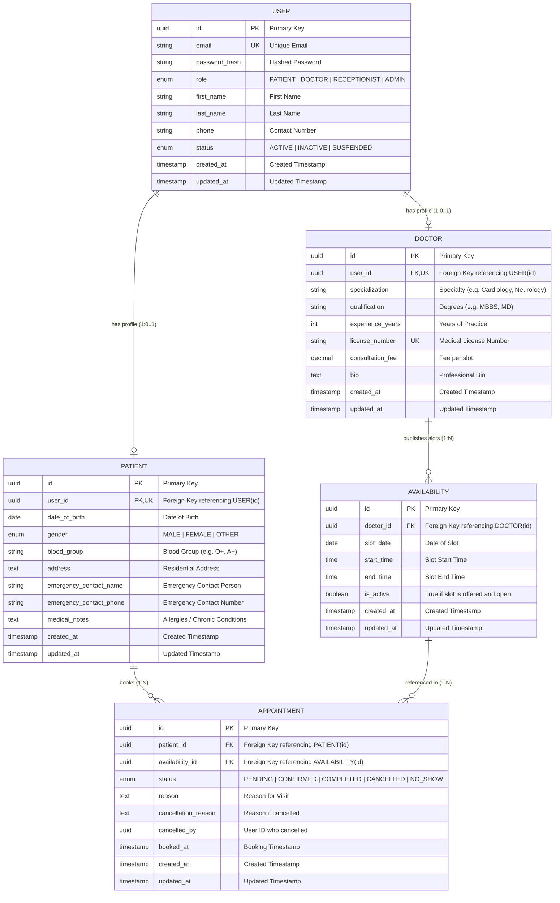

# Hospital Appointment Management System — Entity Relationship (ER) Design

This document details the database architecture and Entity Relationship (ER) model designed for the **Hospital Appointment Management System** (Pearl Thoughts internship assignment).

---

## 1. Tech Stack & Database Architecture
- **Database Engine:** PostgreSQL
- **ORM:** Prisma
- **Backend Runtime & Framework:** Node.js + Express
- **Frontend:** React + Vite
- **Authentication & Security:** JWT, bcrypt password hashing, Role-Based Access Control (RBAC)

---

## 2. Entity Relationship Diagram (Mermaid)

---

## 3. Entities & Data Dictionary

### 3.1 `USER`
Represents authentication and credential management for all actors.
- **`id`** (`UUID`, PK): Unique identifier.
- **`email`** (`VARCHAR(255)`, UK): Unique login email address.
- **`password_hash`** (`VARCHAR(255)`): Securely hashed password (bcrypt / argon2).
- **`role`** (`ENUM`): Defines system privileges: `'PATIENT'`, `'DOCTOR'`, `'RECEPTIONIST'`, `'ADMIN'`.
- **`first_name`**, **`last_name`** (`VARCHAR(100)`): Names.
- **`phone`** (`VARCHAR(20)`): Contact phone number.
- **`status`** (`ENUM`): `'ACTIVE'`, `'INACTIVE'`, `'SUSPENDED'`.
- **`created_at`**, **`updated_at`** (`TIMESTAMP`).

### 3.2 `PATIENT`
Contains patient-specific clinical and demographic records.
- **`id`** (`UUID`, PK).
- **`user_id`** (`UUID`, FK, UK): One-to-one link to `USER.id`.
- **`date_of_birth`** (`DATE`), **`gender`** (`ENUM: MALE, FEMALE, OTHER`).
- **`blood_group`** (`VARCHAR(5)`).
- **`address`** (`TEXT`).
- **`emergency_contact_name`**, **`emergency_contact_phone`** (`VARCHAR`).
- **`medical_notes`** (`TEXT`): Important baseline notes or allergies.

### 3.3 `DOCTOR`
Contains professional credentials, fees, and specialty details.
- **`id`** (`UUID`, PK).
- **`user_id`** (`UUID`, FK, UK): One-to-one link to `USER.id`.
- **`specialization`** (`VARCHAR(150)`): Specialty area (e.g., Cardiology, Orthopedics).
- **`qualification`** (`VARCHAR(150)`): Educational qualifications.
- **`experience_years`** (`INT`): Experience in years.
- **`license_number`** (`VARCHAR(100)`, UK): Verified medical license number.
- **`consultation_fee`** (`DECIMAL(10, 2)`): Fee charge per appointment.
- **`bio`** (`TEXT`): Brief profile summary.

### 3.4 `AVAILABILITY`
Doctor-defined schedule time slots.
- **`id`** (`UUID`, PK).
- **`doctor_id`** (`UUID`, FK): References `DOCTOR.id`.
- **`slot_date`** (`DATE`): Date when the doctor will be available.
- **`start_time`** (`TIME`): Start time (e.g., 09:00:00).
- **`end_time`** (`TIME`): End time (e.g., 09:30:00).
- **`is_active`** (`BOOLEAN`): Set to false if doctor revokes the slot.
- **Constraints:**
  - Compound unique constraint on `(doctor_id, slot_date, start_time)` ensures a doctor cannot have overlapping/duplicate slots.

### 3.5 `APPOINTMENT`
The booking contract between a patient and a doctor's availability slot.
- **`id`** (`UUID`, PK).
- **`patient_id`** (`UUID`, FK): References `PATIENT.id`.
- **`availability_id`** (`UUID`, FK): References `AVAILABILITY.id`.
- **`status`** (`ENUM`): `'PENDING'`, `'CONFIRMED'`, `'COMPLETED'`, `'CANCELLED'`, `'NO_SHOW'`.
- **`reason`** (`TEXT`): Chief medical complaint or visit purpose.
- **`cancellation_reason`** (`TEXT`): Logged if cancelled.
- **`cancelled_by`** (`UUID`): User who initiated cancellation.
- **`booked_at`** (`TIMESTAMP`): Time of confirmation.

---

## 4. Key Relationships & Cardinality

| Relationship | Cardinality | Enforced By | Description |
|---|---|---|---|
| **USER → PATIENT** | 1 : 0..1 | FK (`PATIENT.user_id`) + Unique Index | Every patient is a user; not all users are patients. |
| **USER → DOCTOR** | 1 : 0..1 | FK (`DOCTOR.user_id`) + Unique Index | Every doctor has an auth account; distinct credentials. |
| **DOCTOR → AVAILABILITY** | 1 : N | FK (`AVAILABILITY.doctor_id`) | A doctor creates multiple date/time slots. |
| **PATIENT → APPOINTMENT** | 1 : N | FK (`APPOINTMENT.patient_id`) | A patient can have multiple appointment bookings over time. |
| **AVAILABILITY → APPOINTMENT** | 1 : N | FK (`APPOINTMENT.availability_id`) | A slot maps to bookings. Only one active booking allowed (history preserved). |

