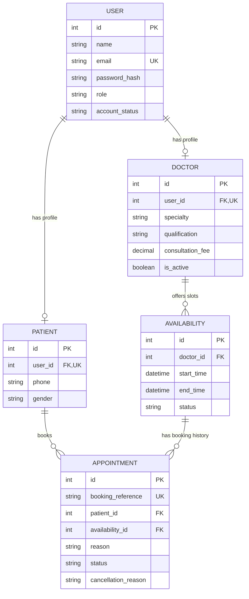

# Hospital Appointment Management System — Entity Relationship (ER) Design

This document details the database architecture and Entity Relationship (ER) model designed for the **Hospital Appointment Management System** (Pearl Thoughts internship assignment).

---

## 1. Entity Relationship Diagram (Mermaid)

---

## 2. Entities & Data Dictionary

### 2.1 `USER`
- **`id`** (`int`, PK): Unique identifier for the user account.
- **`name`** (`string`): Full name of the user.
- **`email`** (`string`, UK): Unique email address used for login.
- **`password_hash`** (`string`): Securely hashed password.
- **`role`** (`string`): Role in the system (e.g. `patient`, `doctor`, `receptionist`, `admin`).
- **`account_status`** (`string`): Status of the account (e.g. `active`, `inactive`, `suspended`).

### 2.2 `PATIENT`
- **`id`** (`int`, PK): Unique identifier for the patient record.
- **`user_id`** (`int`, FK, UK): Reference to `USER(id)`. Ensures a one-to-one link per patient.
- **`phone`** (`string`): Contact phone number.
- **`gender`** (`string`): Gender of the patient.

### 2.3 `DOCTOR`
- **`id`** (`int`, PK): Unique identifier for the doctor record.
- **`user_id`** (`int`, FK, UK): Reference to `USER(id)`. Ensures a one-to-one link per doctor.
- **`specialty`** (`string`): Medical specialty (e.g. Cardiology, Dermatology).
- **`qualification`** (`string`): Professional qualifications / degrees.
- **`consultation_fee`** (`decimal`): Fee charged per consultation.
- **`is_active`** (`boolean`): Active status flag for doctor scheduling.

### 2.4 `AVAILABILITY`
- **`id`** (`int`, PK): Unique identifier for the availability slot.
- **`doctor_id`** (`int`, FK): Reference to `DOCTOR(id)`.
- **`start_time`** (`datetime`): Slot start timestamp.
- **`end_time`** (`datetime`): Slot end timestamp.
- **`status`** (`string`): Slot status (e.g. `available`, `booked`, `cancelled`).

### 2.5 `APPOINTMENT`
- **`id`** (`int`, PK): Unique identifier for the appointment booking.
- **`booking_reference`** (`string`, UK): Unique tracking code / reference string for the appointment.
- **`patient_id`** (`int`, FK): Reference to `PATIENT(id)`.
- **`availability_id`** (`int`, FK): Reference to `AVAILABILITY(id)`.
- **`reason`** (`string`): Reason or chief medical complaint for the visit.
- **`status`** (`string`): Booking status (e.g. `pending`, `confirmed`, `completed`, `cancelled`).
- **`cancellation_reason`** (`string`): Optional note documenting reason if cancelled.

---

## 3. Relationships & Cardinality

| Relationship | Cardinality | Key / Constraint | Description |
|---|---|---|---|
| **USER → PATIENT** | One-to-Zero-or-One (`||--o|`) | `PATIENT.user_id` (FK, UK) | A user can have at most one patient profile. |
| **USER → DOCTOR** | One-to-Zero-or-One (`||--o|`) | `DOCTOR.user_id` (FK, UK) | A user can have at most one doctor profile. |
| **DOCTOR → AVAILABILITY** | One-to-Many (`||--o{`) | `AVAILABILITY.doctor_id` (FK) | A doctor publishes multiple availability slots. |
| **PATIENT → APPOINTMENT** | One-to-Many (`||--o{`) | `APPOINTMENT.patient_id` (FK) | A patient can book multiple appointments over time. |
| **AVAILABILITY → APPOINTMENT** | One-to-Many (`||--o{`) | `APPOINTMENT.availability_id` (FK) | A slot connects to bookings to maintain appointment history. |
